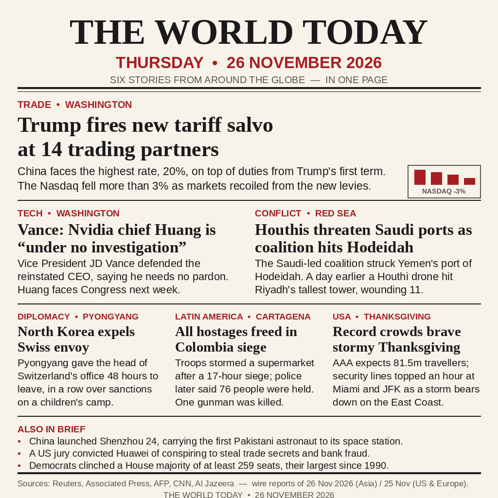

[](https://make.fun/competitions/news-image-20261126)
[](https://make.fun/competitions/news-image-20261126)
[](https://make.fun/competitions/news-image-20261126)

# The World Today — 26 November 2026

A one-page newspaper front page summing up the world news of
**Thursday 26 November 2026**, drawn from scratch in code
(Python + PIL: vector shapes and system fonts only — no photos,
no copied images, no AI-generated art).



## The stories

**Lead — Trade: Trump fires new tariff salvo at 14 trading partners.**
The US administration proposed new tariffs on 14 major trading
partners, with China facing the highest rate, 20%, on top of duties
from Trump's first term; the Nasdaq fell more than 3%.
Sources: Reuters, Associated Press, Al Jazeera.

**Tech: Vance says Nvidia chief Huang is "under no investigation".**
Vice President JD Vance defended the reinstated Nvidia CEO Jensen
Huang, saying he needs no pardon; Huang is due before Congress
the following week. Sources: Associated Press, CNN, New York Post.

**Conflict: Houthis threaten Saudi ports as coalition hits Hodeidah.**
The Saudi-led coalition struck Yemen's port of Hodeidah; a day
earlier a Houthi drone hit Riyadh's tallest tower, wounding 11,
and Houthi fighters stood about 60 km from Aden.
Sources: Reuters, Associated Press, Daily Sabah.

**Diplomacy: North Korea expels Swiss envoy.** Pyongyang declared
the head of Switzerland's diplomatic office persona non grata and
gave him 48 hours to leave, in a row over Swiss sanctions on the
Songdowon International Children's Camp. Sources: KCNA via
Al Jazeera, Korea Times, NHK, Yonhap.

**Latin America: All hostages freed in Colombia siege.** Security
forces stormed an Éxito supermarket in Cartagena after a 17-hour
siege; police later said 76 people were held and one gunman was
killed. Sources: Al Jazeera, AFP via Arab News.

**USA: Record crowds brave stormy Thanksgiving.** AAA projected
81.5 million Americans travelling for Thanksgiving; security lines
topped an hour at Miami and JFK as a storm bore down on the East
Coast. Source: Associated Press (dateline 26 November 2026).

**Also in brief:** China launched Shenzhou 24, carrying the first
Pakistani astronaut to its space station (AP); a US jury convicted
Huawei of conspiring to steal trade secrets and bank fraud (AP);
Democrats clinched a House majority of at least 259 seats, their
largest since 1990 (AP).

All six main stories were reported in wire coverage dated
26 November 2026 in Asia, or on 25 November in the US and Europe
and carried in 26 November editions; the Thanksgiving travel story
is datelined 26 November 2026 itself. Only facts already reported
at the time of drawing were used — nothing was invented.

## How it is made

- `draw_entry.py` — draws `entry.png` (1024×1024 PNG) from scratch.
- `main.ts` — the entry program (Node 22, standard library only).
  It copies `entry.png` to `$MAKEFUN_OUTPUT_DIR/entry.png`
  (default `./out`) and verifies the output is a PNG under 1 MiB.

## Run it

```sh
python3 draw_entry.py   # regenerate entry.png (optional)
node main.ts            # writes ./out/entry.png
```

Two runs produce byte-identical output
(sha256 `2f2034bb8ded4229697cdecfca12685dbb02e96004188daf9ec1fe2a43bd567f`).
